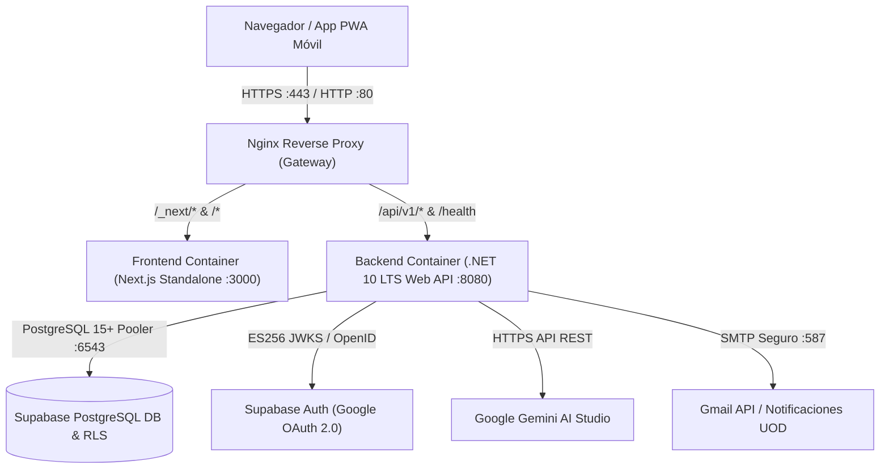

# Guía de Despliegue en Producción con Docker y Nginx – SIIA (UOD)

> **Sistema Inteligente de Inventario y Activos UOD (SIIA)**  
> **Universidad Odontológica Dominicana**  
> **Arquitectura:** .NET 10 LTS Web API + Next.js 16 Standalone + PostgreSQL Supabase + Nginx Gateway

---

## 1. Arquitectura del Entorno de Contenedores



---

## 2. Requisitos Previos del Servidor

- **Sistema Operativo:** Ubuntu 22.04 LTS o 24.04 LTS (o cualquier distribución Linux con kernel $\ge 5.15$).
- **Hardware Recomendado:**
  - CPU: 2 vCPUs o superior.
  - Memoria RAM: 4 GB mínimo (8 GB recomendado).
  - Almacenamiento: 25 GB SSD/NVMe.
- **Software Requerido:**
  - Docker Engine $\ge 24.0.0$
  - Docker Compose v2 (`docker compose version`)

---

## 3. Instalación de Docker y Docker Compose (en Ubuntu Server)

Si el servidor aún no tiene Docker instalado, ejecutar:

```bash
# Actualizar repositorios e instalar paquetes base
sudo apt update && sudo apt upgrade -y
sudo apt install -y ca-certificates curl gnupg lsb-release

# Agregar clave GPG oficial de Docker
sudo install -m 0755 -d /etc/apt/keyrings
curl -fsSL https://download.docker.com/linux/ubuntu/gpg | sudo gpg --dearmor -o /etc/apt/keyrings/docker.gpg
sudo chmod a+r /etc/apt/keyrings/docker.gpg

# Agregar repositorio de Docker
echo \
  "deb [arch="$(dpkg --print-architecture)" signed-by=/etc/apt/keyrings/docker.gpg] https://download.docker.com/linux/ubuntu \
  "$(. /etc/os-release && echo "$VERSION_CODENAME")" stable" | \
  sudo tee /etc/apt/sources.list.d/docker.list > /dev/null

# Instalar Docker Engine y Compose
sudo apt update
sudo apt install -y docker-ce docker-ce-cli containerd.io docker-buildx-plugin docker-compose-plugin

# Permitir ejecutar docker sin sudo (opcional)
sudo usermod -aG docker $USER
newgrp docker
```

---

## 4. Puesta en Marcha Paso a Paso

### Paso 1: Clonar el Repositorio
```bash
git clone https://github.com/RyamAbel/SistemaUOD.git
cd SistemaUOD
```

### Paso 2: Crear el Archivo de Variables de Entorno `.env`
Copiar la plantilla y suministrar las claves institucionales:

```bash
cp .env.docker.example .env
nano .env
```

Configurar las variables mínimas:
- `SUPABASE_URL`: URL del proyecto Supabase institucional.
- `SUPABASE_ANON_KEY`: Llave pública anónima de Supabase.
- `SUPABASE_SERVICE_ROLE_KEY`: Llave confidencial `service_role`.
- `DATABASE_CONNECTION_STRING`: Cadena de conexión al pooler PostgreSQL (puerto 6543 en Supabase).
- `GEMINI_API_KEY`: API Key de Google AI Studio.
- `GMAIL_USER` y `GMAIL_APP_PASSWORD`: Correo institucional y clave de aplicación de 16 caracteres.

### Paso 3: Despliegue con Docker Compose (Modo Producción con Nginx)

```bash
# Construir imágenes e iniciar contenedores en segundo plano
docker compose -f docker-compose.prod.yml up -d --build
```

### Paso 4: Verificación del Estado de los Contenedores
```bash
docker compose -f docker-compose.prod.yml ps
```

Deberá mostrar los tres servicios en estado `healthy` o `running`:
- `siia_backend_prod`: `Up (healthy)`
- `siia_frontend_prod`: `Up (healthy)`
- `siia_gateway_prod`: `Up (running)`

Verificar las comprobaciones de salud del backend:
```bash
curl -I http://localhost/health
# Debe retornar HTTP/1.1 200 OK
```

---

## 5. Configuración de Certificados SSL / HTTPS (Let's Encrypt)

Para producción con dominio institucional (`siia.uod.edu.do`):

1. Instalar Certbot en el servidor anfitrión:
   ```bash
   sudo apt install -y certbot
   ```
2. Detener temporalmente el gateway de Nginx para liberar el puerto 80:
   ```bash
   docker compose -f docker-compose.prod.yml stop gateway
   ```
3. Generar el certificado:
   ```bash
   sudo certbot certonly --standalone -d siia.uod.edu.do
   ```
4. Mapear los certificados en `docker-compose.prod.yml` bajo el servicio `gateway`:
   ```yaml
   volumes:
     - ./nginx/nginx.conf:/etc/nginx/nginx.conf:ro
     - /etc/letsencrypt:/etc/letsencrypt:ro
   ```
5. Iniciar nuevamente el gateway:
   ```bash
   docker compose -f docker-compose.prod.yml up -d gateway
   ```

---

## 6. Monitoreo y Mantenimiento

### Ver Registros en Vivo
```bash
# Ver registros de todos los servicios
docker compose -f docker-compose.prod.yml logs -f --tail=100

# Ver registros específicos del backend
docker compose -f docker-compose.prod.yml logs -f backend

# Ver registros específicos del Asistente IA / Frontend
docker compose -f docker-compose.prod.yml logs -f frontend
```

### Actualización de Versión (Zero Downtime)
```bash
git pull origin main
docker compose -f docker-compose.prod.yml build
docker compose -f docker-compose.prod.yml up -d --no-deps backend frontend
```

### Copias de Seguridad (Backup)
Dado que la base de datos reside en Supabase PostgreSQL:
- Se realizan copias de seguridad automáticas diarias administradas en Supabase.
- Para realizar un volcado local periódico:
  ```bash
  pg_dump "Host=aws-0-us-east-1.pooler.supabase.com;Port=6543;Database=postgres;Username=postgres.xgwuxkvbdwxwflynanwo;SSL Mode=Require" -f backup_$(date +%Y%m%d).sql
  ```
